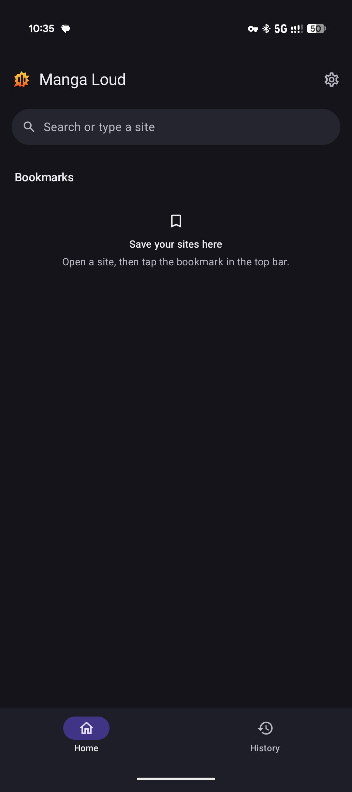
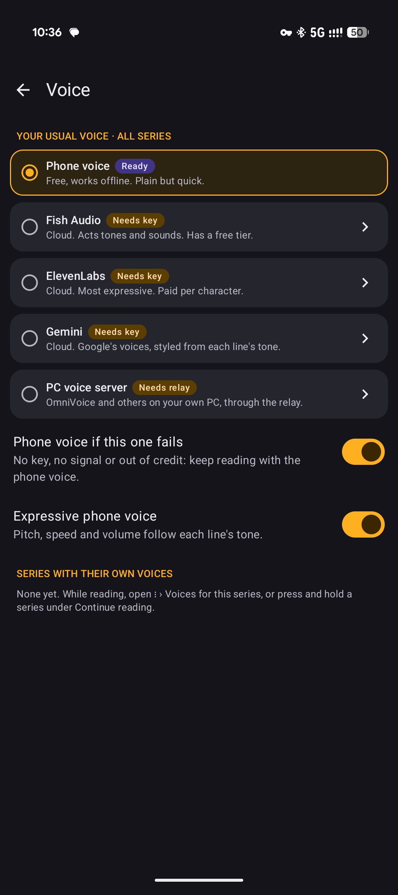
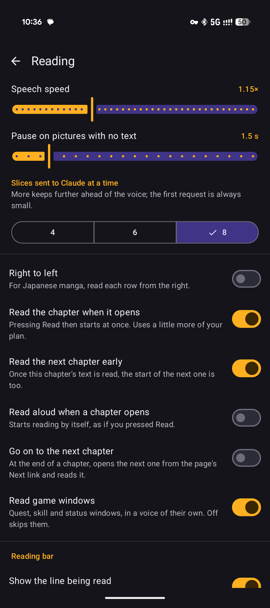

# Manga Loud

<p align="center"></p>

An Android browser for manga, manhwa and webtoon sites that reads the speech bubbles aloud and
scrolls the page smoothly along with the voice. It has a built-in ad and pop-up blocker.

<p align="center">
  
  
  
</p>

**Try it:** open the [demo chapter](https://aarul5.github.io/mangaloud/demo/chapter-1/) in the app
and press Read aloud. It's a short comic made for this project, with speech, a shout, a whisper,
a thought, narration, a game window and a cough, so you can hear each kind of line.

## How it works

1. You open a chapter in the app and tap **Read**.
2. The app finds the chapter images on the page and downloads them with the page's cookies.
3. Tall webtoon strips are cut into screen-sized slices that overlap, so no bubble is lost on a cut.
4. Slices go to Claude in batches of four. Settings > "Slices per request" can raise that to six
   or eight, which keeps further ahead of the voice; the first batch is just two slices, so the
   voice starts sooner. When a chapter page opens, its first eight slices are read straight away
   (Settings can turn this off), so Read usually starts at once. Two batches are read at the same time, which roughly doubles how fast the
   text keeps ahead of the voice. Claude returns each bubble's text, position, type, speaker,
   tone and how strong the tone is. Sound effects are dropped. How Claude reads a page is set out
   in a reading guide (see below).
5. The voice you chose reads each bubble: the phone's own, a cloud voice, or your PC (see Voices). Before each one, the page glides to it and
   highlights it. Leaving the app or taking a call pauses the reading, and it carries on
   from the same bubble when you come back.
6. Text reading runs a few pages ahead of the voice. Results are cached on the phone, so a chapter
   is only sent once.
7. Settings > Reading can start reading by itself when a chapter opens, and go on to the next
   chapter when one ends: the reading bar counts down "Next chapter in 3…" (with Cancel and Go
   now), opens the page's Next link and reads it. Both are off by default.
8. Once a chapter's text is all read, the app reads the first 16 slices of the next chapter too,
   so pressing Read there starts straight away. It finds the next chapter from the page's "next"
   link, and its images from that page's HTML, so sites that add their images by script are
   skipped. Turn it off in Settings.

## Kinds of text and sounds

Claude labels each piece of text as dialogue, a thought, narration, a game window (quests,
skills, stats), a reaction (a sound a character makes: cough, shriek, groan, sigh, gasp, laugh,
sob, pant or grunt) or a drawn sound effect. Sound effects are never read. A bubble with a sound
and words ("Cough! I'm fine") is listed as two lines. The bubble's shape is one of the clues for
the tone: jagged or burst for shouting, wobbly for fear, dashed or tiny for a whisper, cloud or
fuzzy for a thought, icicles or a black bubble for menace, hearts or sparkles for warmth, and
square or electronic for a voice over a phone or radio.

- Thoughts are read a little quieter, in the character's own voice, unless they are urgent or end
  in "!" ("It's him!").
- Game windows have a man's voice of their own. Settings > Reading > "Read game windows" turns them off.
- With Fish Audio, reactions are acted as sounds: "Kyaa!" with a scream, "Haah..." with a sigh,
  "Hahaha!" with a laugh, and "Cough! I'm fine" with a cough before the words. The relay also
  spots sounds by their words for older apps.
- The phone voice cannot cough or sigh, so it leaves a short pause for those and says the rest
  ("Agh!", "Kyaa!").

## The reading guide

`relay/skills/read-comic.md` tells Claude how to read a page: scan every slice, count the pieces
of text and check the count before answering, so small or unboxed text is not missed; how to
tell who is speaking (the known characters and what they look like, the last few lines read
before the batch, bubble tails, names in speech); and how to judge the tone and its strength
(1 mild, 2 clear, 3 extreme) from the faces, bubble shapes and the scene.

The relay reads this file fresh for every request, so you can edit it on the PC and the next
batch uses it; no new app is needed. The app bundles the same file for Claude API mode, so a
change there needs a new APK. Bubbles read before a guide change stay cached on the phone;
clearing the app's cache reads them again.

When a line is missed or misread, look in `relay/debug`: the relay keeps the last 40 requests
there, each with its slices, the app's part of the prompt (characters and recent lines) and
Claude's reply, so you can see which slice it was and what came back. Set `DEBUG_KEEP=0` to turn
this off.

## Two ways to read the text

Pick one in **Settings** (the gear icon).

| Option     | Needs                                         | Notes                                                                                                |
| ---------- | --------------------------------------------- | ---------------------------------------------------------------------------------------------------- |
| Claude API | An API key from console.anthropic.com         | Works anywhere. Paid per use. Default model `claude-opus-5-5`, change it in Settings.                |
| PC relay   | Your Claude Pro plan, and this PC switched on | The phone sends slices to `relay/server.mjs`, which runs `claude -p`. Uses your plan's usage limits. |

## Install the app

Build it:

```bash
cd android && ./gradlew assembleDebug
```

The APK lands in `android/app/build/outputs/apk/debug/app-debug.apk`.

Install it on a phone connected by USB, with USB debugging on:

```bash
adb install -r android/app/build/outputs/apk/debug/app-debug.apk
```

## Run the PC relay

The relay runs on a Windows, macOS or Linux computer. You need:

- **Node.js 20 or newer.**
- **Claude Code** (the `claude` command), signed in to your Claude plan. The relay reads pages
  with `claude -p`. Voices only, with no page reading, work without it.
- **Tailscale** on the computer and the phone, signed in to the same account. The relay listens
  on the computer's Tailscale address (`100.x.x.x`) only, so the token is encrypted on the way
  and reading works away from home too.

Start it in a terminal to try it:

```bash
cd relay
node server.mjs
```

On macOS and Linux, `relay/run-relay.sh` does the same.

It prints the relay address and token, and a setup link (`mangaloud://setup?…`, also saved in
`relay/setup-link.txt`). Open the link on the phone, or copy it and tap Settings > PC relay >
Paste setup link, and the app adds the relay for you. The link holds the token, so only send it
to your own phone. You can also type the address and token into Settings by hand.

### Start it at sign-in

The relay then starts when you sign in, and starts again whenever it stops. Its output goes to
`relay/logs/relay.log`, which only your user can read because it shows the token.

| System | Install | Remove |
|---|---|---|
| Windows | `powershell -ExecutionPolicy Bypass -File relay\install-autostart.ps1` (a scheduled task) | `relay\uninstall-autostart.ps1` |
| macOS | `relay/install-autostart.sh` (a launchd agent) | `relay/uninstall-autostart.sh` |
| Linux | `relay/install-autostart.sh` (a systemd user service) | `relay/uninstall-autostart.sh` |

- Run the install again after moving the folder or updating Node.js, so it has the new paths.
  `relay/install-autostart.sh --dry-run` shows what it would install without changing anything.
- On Linux the service stops when you sign out unless you run `loginctl enable-linger "$USER"`.
- If Tailscale is not up yet when you sign in, the relay stops and tries again 10 seconds later.
- Windows asks to let Node through the firewall the first time. Allow it.

### More relay settings

You can save more than one relay (Settings > PC relay > Add), for example one per computer or per
Tailscale network. Long-press the gear icon to switch between them.

- The token is saved in `relay/.token`. Delete that file to make a new one.
- Optional env vars: `PORT` (default 8787), `RELAY_TOKEN`, `CLAUDE_BIN` (default `claude`),
  `TAILSCALE_BIN`, `HOST`. `HOST=0.0.0.0` also listens on plain Wi-Fi, where the token is sent
  unencrypted. The app refuses a non-Tailscale address unless "Allow a plain Wi-Fi address" is
  ticked in Settings.

Each relay in Settings has a model (Fable, Opus, Sonnet or Haiku) and an effort (low to max) for
`claude -p`. "Default" leaves it to that computer's own `claude` setting. Haiku or Sonnet at low
effort reads a batch quicker than Opus, and uses less of your plan. The relay log shows the model
and effort used for each batch. Tick Settings > "Show which model read the text" to see the model
and time for the last batch under the bubble text, too.

The relay only lets `claude` use its Read tool, inside a temp folder holding the slices, and runs
one request at a time.

On the phone, the Claude API key, the relay tokens and voice API keys are stored encrypted with the
Android Keystore.

## Voices

Settings > Voice chooses who reads the bubbles:

| Voice | Needs | Notes |
|---|---|---|
| Phone voice | nothing | Free and offline. Pitch and speed follow each line's tone. |
| Fish Audio | a Fish Audio API key | Acts tones and sounds with cues (`[very angry]`, `[sobbing]`). Has a free model. |
| ElevenLabs | an ElevenLabs API key | Expressive (`eleven_v4`, with audio tags like `[whispers]`) or fast and cheaper (`eleven_flash_v2_5`). Paid per character. |
| Gemini | a Gemini API key | `gemini-3.8-flash-tts` or the lite model, with Google's 30 built-in voices and a style for each line's tone. |
| PC voice server | the PC relay and an OmniVoice voice server | Optional, for people who run their own voice server (see below). |

Cloud voices are called straight from the phone with your own key, so no PC is needed. The
key is stored encrypted with the Android Keystore and only sent to that service. The line's
text goes to the service you pick. Clips are kept on the phone, so reading a chapter again
costs nothing.

**Your usual voices.** Each cloud voice has a voice for every kind of speaker: narrator, game
windows, man, woman, boy, girl, old man, old woman and creature. Fish and Gemini start with
voices chosen for each; ElevenLabs picks from your account's voices by their gender and age
labels once the key works. Tap a speaker to choose another from the provider's library, with a
sample for each.

**Voices for one series.** A series can use a different provider, change any speaker's voice,
and give its characters their own voice. Open it from the browser menu (⋮ > Voices for this
series), by holding a series under Continue reading on Home, or from Settings > Voice. A series
keeps only what you change, so it follows later changes to your usual voices. For each line
the app uses the character's own voice, then the series' voice for that speaker type, then
your usual voice.

**When a voice fails** (no key, no signal, out of credit, or too slow), the phone voice reads
that line and the app says why once. Turn off "Phone voice if this one fails" to stop reading
with the reason instead.

## PC voice server (optional)

Settings > Voice > PC voice server reads the bubbles with a voice server running OmniVoice on
the PC, through the relay. It acts the line from its tone and gives each kind of speaker its own voice.

- **Normal quality** sounds best. On an RTX 2080 a line takes about 1.6 times as long to make
  as to play, so there can be short pauses between lines.
- **Fast** makes a line in about the time it plays, so reading keeps going.

Settings > Voice > **PC voice model** picks the voice server's speech model:

- **OmniVoice** (default): each line is acted from its tone with OmniVoice's own settings.
- **Qwen3-TTS**: clones the character's voice and acts the tone with one of the voice server's
  expression presets (`happy`, `sad`, `dramatic`...), stronger or milder with the line's
  intensity. Normal or fast and speech speed do not apply.
- **VibeVoice**: clones the character's voice; the delivery follows the voice clip, not the tone.
- **Fish Audio (cloud)**: Fish Audio's S2.1 model clones the character's voice and acts the tone
  with a cue in front of the line (`[very angry]`, `[whispering]`, `[sobbing]`...). It runs on
  Fish's servers, so it is quick and does not use the PC's GPU, but the text and the voice clips
  are sent to Fish Audio.

Qwen3-TTS and VibeVoice take far longer per line (about 17 to 30 seconds against 2 to 3 on
the test PC), so the phone voice reads any line whose clip is not ready in time. The voices
themselves are always made with OmniVoice; the other models clone them.

To use Fish Audio, create an API key at fish.audio and save it in `relay/fish-key.txt` (or set
`FISH_API_KEY`). The relay uses Fish's free model, `s2.1-pro-free`, which Fish says has no hard
cap under its fair use policy but is offered for a limited period. Set `FISH_MODEL=s2.1-pro` for
the paid model (US$15 per million bytes of text, about US$0.20 for a 180-line chapter). Up to
three lines are made at once. New character voices are still designed with the voice server, so it
needs to be running the first time a speaker type or character is heard.

To set it up, the voice server must be running on the same PC as the relay. Save its API key
in `relay/voice-key.txt` (or set `VOICE_SERVER_KEY`). The relay calls `https://127.0.0.1:8000`
unless `VOICE_SERVER_URL` says otherwise.

The relay works with any server that offers this API:

- `POST /api/v1/tts` with `Authorization: Bearer <key>` and a `multipart/form-data` body, answering
  with a WAV file.
- Fields: `text` (the line), `format` (`wav`), and either `instruct` (a voice description such as
  `male, young adult, moderate pitch`, to design a new voice) or an `audio` file plus `ref_text`
  (a reference clip and its words, to clone that voice).
- OmniVoice also gets `params`, a JSON object of its generation settings (`num_step`,
  `guidance_scale`, `speed` and others). Qwen3-TTS gets `model`, `language`, `expression` and
  `expression_strength`; VibeVoice gets `model` and `language`.
- A server on `127.0.0.1` may use a self-signed certificate; any other address must have a valid one.

The first line for each speaker type (narrator, man, girl...) also makes that speaker's voice
and saves it in `relay/voices`. Delete a file there to get a new voice for that speaker.

### Character voices

Claude labels who says each line, by name when the story gives one, or by a look that stays
the same ("black-haired swordsman"). The main character is always labelled `hero`, so they keep
one voice through new outfits, helmets and disguises. The app keeps a list of each series' characters and sends
it with every batch, with each character's age and gender and a short description of their look
("young man, spiky white hair"), so the same person gets the same label in later chapters. The
last six lines read before each batch go with it too, so a conversation carries on from one batch
to the next. A series is
named from the chapter address, so most sites keep one list per series. A site whose chapter
addresses leave out the series shares one list for the whole site.

The relay gives each named character one of several voices for their speaker type the first
time they speak, and keeps it for the series. Their age and gender are fixed at that point too,
so a later misread does not change their voice. Lines with no clear speaker use the plain voice
for their type. The choices are saved in `relay/voices/cast/`, one file per series.

To change a PC voice, open Settings > Voice > PC voice server > "Character voices on the PC". Pick a character to fix their age and gender (when Claude took them for the wrong one),
choose another voice, write your own description, make it soft or playful, or give them the same voice as another character, for when one person ends up under two
labels (a new outfit, or their name instead of a description). "Save and play" plays a sample.
The phone forgets the clips it saved, so the new voice is heard straight away.

You can also edit the file by hand: change a character's `variant` (0 is the plain voice), set
`"sameAs": "<other character's key>"`, or add a description
of your own, such as `"voice": "male, teenager, low pitch"`. The words OmniVoice understands are
gender, age (child, teenager, young adult, middle-aged, elderly), pitch (very low to very high)
and English accents. Add `"soft": true` for a gentler voice that also acts loud lines with
restraint, or `"playful": true` to keep the voice but act every line in a bouncy, childish
way. Delete the file to start the series again. The phone voice also shifts the pitch a little per character. Clips
are cached in `relay/cache/voice` on the PC and on the phone, so a chapter read again plays
straight away. If a clip fails or takes over 8 seconds, the phone voice reads that line and the
app says so once. If the relay cannot be reached at all (PC off, Tailscale down), the phone voice
reads straight away, with no wait, and the PC is tried again every 30 seconds.

## Ad blocker

- Requests to known ad and pop-up hosts are blocked. The list is a built-in one plus a public list
  downloaded on first launch (Settings > Update ad blocklist).
- Pop-up windows and `alert()` spam are blocked.
- Jumps to a different site are held. The status line shows "Blocked a jump to …". Tap it to open
  the site anyway.

## Contributing

Bug reports, fixes and new voice providers are welcome. See [CONTRIBUTING.md](CONTRIBUTING.md)
for how to build and test, and [SECURITY.md](SECURITY.md) for reporting security problems
privately. Everyone taking part follows the [Code of Conduct](CODE_OF_CONDUCT.md).

## Credits

- The downloaded ad blocklist is [HaGeZi's DNS blocklists](https://github.com/hagezi/dns-blocklists)
  (Pro, domains only), GPL-3.0.

## Licence

Manga Loud is free software under the [GNU General Public License v3.0](LICENSE). You can use,
study, change and share it; copies and changed versions you share must stay under the same
licence.

Manga Loud is a browser and reader. It ships with no comic sites and no comics. Use it only with
content you are allowed to read.
